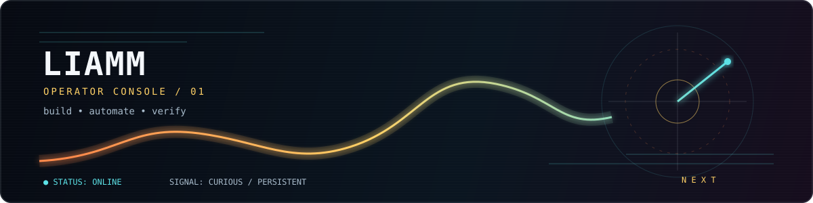

<div align="center">
  
</div>

<h1 align="center">liamm</h1>

<p align="center">
  <code>software · automation · infrastructure</code>
</p>

<p align="center">
  <a href="https://github.com/ynotliam">github</a>
  ·
  <a href="https://github.com/ynotliam?tab=repositories">projects</a>
  ·
  <a href="https://github.com/ynotliam?tab=stars">starred</a>
</p>

---

### `now() == "building with intent"`

I like turning fuzzy ideas into systems that are **useful, observable, and hard to break**.

```text
focus       reliable software + practical automation
mode        curious, iterative, quietly persistent
principle   make it work → make it clear → make it last
```

### signal board

| signal | status |
| :--- | :--- |
| learning | always on |
| shipping | one useful increment at a time |
| documentation | part of the build |
| “works on my machine” | not an acceptance criterion |

### operating principles

- Prefer small, reversible changes.
- Automate the boring parts, then verify the automation.
- Treat observability as a feature.
- Leave systems clearer than I found them.

### currently exploring

`AI agents` · `developer tooling` · `DevOps workflows` · `clean interfaces` · `reliable automation`

<br />

<div align="center">
  <sub>Built with curiosity. Verified with evidence.</sub>
</div>
